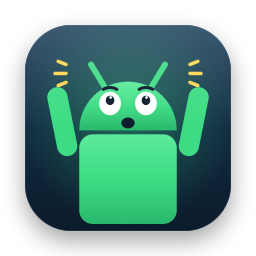
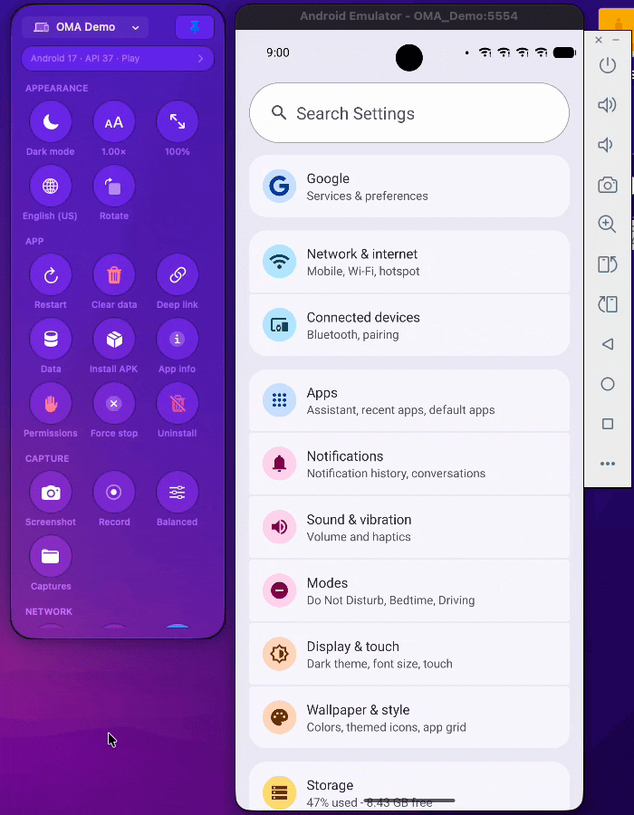
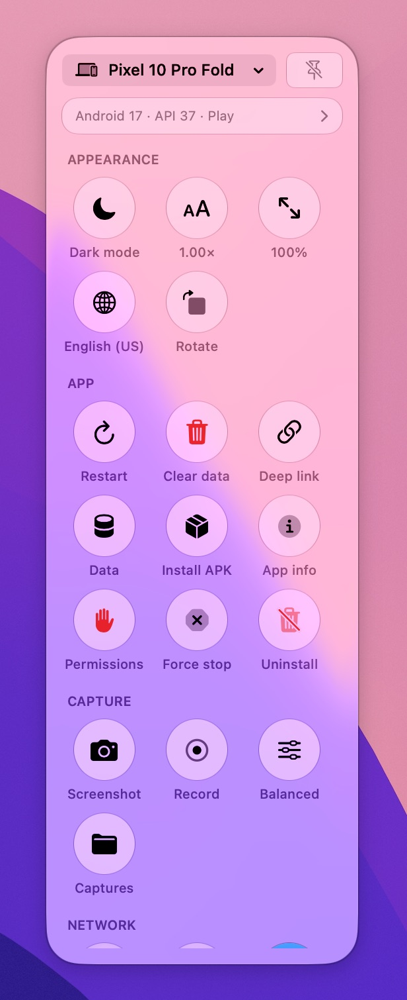
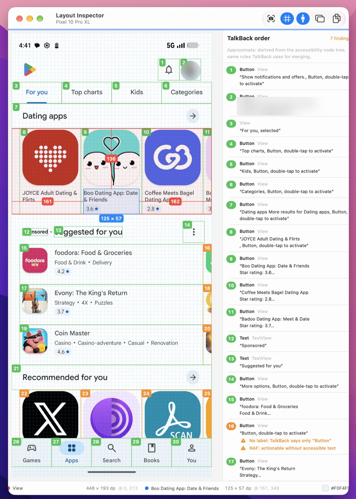
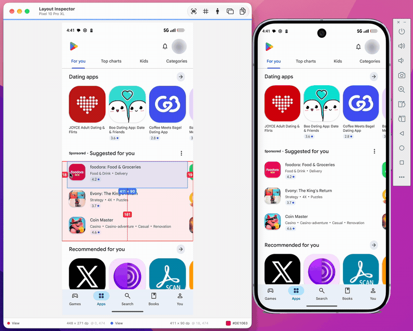
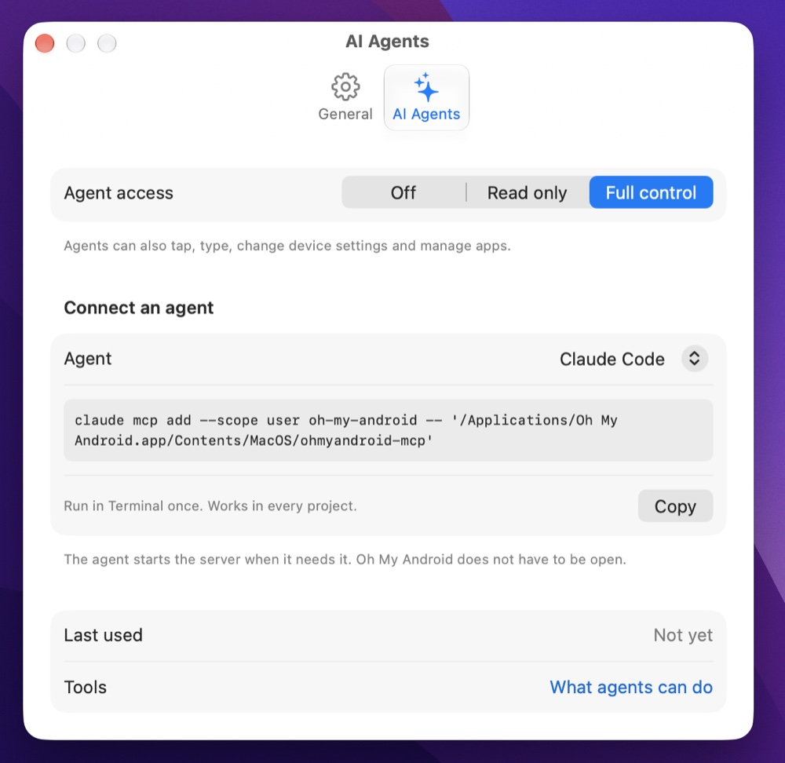

<p align="center">
  
</p>

<h1 align="center">Oh My Android</h1>

<p align="center">
  <b>Test your Android app in dark mode, big fonts, RTL and TalkBack: one click each, no adb commands.</b><br>
  A free, native ADB GUI for Mac that docks next to the Android Emulator. Works with real phones too.
</p>

<p align="center">
  <a href="https://github.com/ateymoori/oh-my-android/releases/latest"></a>
  <a href="#install"></a>
  
  <a href="https://androidweekly.net/issues/issue-747"></a>
  <a href="LICENSE"></a>
  <a href="https://github.com/ateymoori/oh-my-android/stargazers"></a>
</p>

<p align="center">
  
  <br><sub>Dark mode, font size, Arabic RTL, incoming SMS and call. Each is one click.</sub>
</p>

## Install

```sh
brew install --cask ateymoori/tap/oh-my-android
```

<sub>Or the signed, notarized zip from <a href="https://github.com/ateymoori/oh-my-android/releases/latest">Releases</a> · macOS 26 Tahoe+ · Apple silicon · uses the Android SDK you already have (<a href="#updates-and-requirements">details</a>) · ⭐ star to help more Android devs find it</sub>

- 🎛️ **Nearly 50 test actions, always visible.** Dark mode, font and display size, language and locale incl. RTL and pseudo-locales, TalkBack, bold text, layout bounds, show taps, animations off, network speed, GPS, incoming call and SMS. Each icon shows the device's real state.
- 📐 **Layout Inspector in dp, for any app.** Hover a view to see its size and the gaps around it in dp, for Compose and Views alike. Drop your Figma export on top to compare design and build. ⇧⌘A numbers the TalkBack stops and flags missing labels and touch targets under 48 dp.
- 🗄️ **Your debug build, without adb.** Read SharedPreferences and SQLite, clear data, open deep links, drag an APK to install, reset permissions.
- 🪶 **Native and light.** SwiftUI, event-driven, no Electron, no telemetry. Free and open source (MIT).

> **Why not just Android Studio?** Studio's Device UI shortcuts already give one-click dark mode, font size,
> app language and TalkBack (API 33+). Use them when Studio is open. Oh My Android adds one always-visible panel
> for emulators *and* phones that works with Studio closed, toggles the shortcuts don't have (bold text,
> pseudo-locales, layout bounds, show taps, animations), and dp measurements on any app, where Studio's
> Layout Inspector needs a debuggable one. Compared with Studio, scrcpy and mobile-mcp: [docs/COMPARISON.md](docs/COMPARISON.md).

> 🤖 **Using Claude Code, Codex or Cursor?** The app ships an MCP server (18 tools) so your agent can
> screenshot the emulator in dp, tap, and switch dark mode or RTL. [Set it up →](#ai-agents-mcp)

<table align="center">
  <tr>
    <td align="center"><a href="#features"></a></td>
    <td align="center"><a href="#layout-inspector"></a></td>
  </tr>
  <tr>
    <td align="center"><b>Control panel</b></td>
    <td align="center"><b>Layout Inspector + TalkBack audit</b></td>
  </tr>
</table>

<p align="center">
  <a href="#features">Features</a> ·
  <a href="#no-more-adb-commands">adb cheat sheet</a> ·
  <a href="#layout-inspector">Layout Inspector</a> ·
  <a href="#ai-agents-mcp">AI agents (MCP)</a> ·
  <a href="#troubleshooting">Troubleshooting</a> ·
  <a href="#faq">FAQ</a> ·
  <a href="CONTRIBUTING.md">Contribute</a> ·
  <a href="https://royan.se/work/oh-my-android/">Website</a>
</p>

## Features

| | What you get |
|---|---|
| 🎨 **Appearance** | Dark mode · Font size (0.85× → 2×) · Display size · Language and locale, incl. RTL and pseudo-locales · Rotate |
| 📦 **Your app** (whatever is on screen) | Restart · Clear data · Open deep link · Install APK (or drag it onto the panel) · App info · Reset permissions · Force stop · Uninstall |
| 📸 **Capture** | Screenshot saved and copied to the clipboard · Screen recording with audio · Quality presets |
| 🌐 **Network** | Emulate LTE, HSDPA, 3G, EDGE, GPRS or GSM speed and latency · Airplane mode · Wi‑Fi · Mobile data |
| 📐 **Layout & performance** | Layout Inspector · Show layout bounds · GPU overdraw · GPU profile bars · Show taps · Pointer location · Animations off (for Espresso / Maestro) · Developer options |
| ♿ **Accessibility** | TalkBack on/off · Bold text · Invert colors · TalkBack order audit |
| 🧭 **Navigation & input** | Back · Home · Recents · Type text into the focused field · Hide keyboard |
| 🛰️ **Simulate** (emulator) | GPS location: city presets or latitude/longitude · Battery level · Charging · Fingerprint · Incoming call · Incoming SMS |
| 💾 **Snapshots** (emulator) | Save a clean state and restore it in seconds |

Destructive actions (Clear data, Uninstall, Reset permissions) ask before they run.

## Updates and requirements

Besides Homebrew, you can download the zip from the [latest release](https://github.com/ateymoori/oh-my-android/releases/latest),
unzip it, and move **Oh My Android.app** to Applications. The app is signed and notarized by Apple.

**Updates:** when a new version is out, a dot shows on the menu bar icon. Click **Update to …** in the
menu, read what's new, and install in one click. The app never updates without asking. It checks once a
day; turn it off in **Settings → Updates**. `brew upgrade --cask oh-my-android` works too.

**Requirements:** macOS 26 Tahoe or later, Apple silicon, and the Android SDK from
[Android Studio](https://developer.android.com/studio) (or `brew install --cask android-commandlinetools`).
The app finds the SDK by itself. If yours is in an unusual folder, pick it in **Settings → Android SDK**.

## No more adb commands

Every icon replaces a command you would otherwise type or search for:

| Task | The adb way | Oh My Android |
|---|---|---|
| Dark mode on the emulator | `adb shell cmd uimode night yes` | 🌙 one click |
| Bigger font size | `adb shell settings put system font_scale 1.3` | Aa − / + |
| Change the device language | `adb shell cmd locale set-device-locale sv-SE` | 🌐 pick from a menu |
| Test RTL layout | `adb shell cmd locale set-device-locale ar-EG` | 🌐 "العربية (RTL)" |
| Slow network (3G / EDGE) | `adb emu network speed edge` + `adb emu network delay edge` | pick a profile |
| Mock GPS location | `adb emu geo fix 18.0686 59.3293` | pick a city |
| Turn off animations for UI tests | 3 × `adb shell settings put global …_scale 0` | one click |
| Show layout bounds | `adb shell setprop debug.layout true` + a system refresh call | one click |
| Clear app data | find the package, then `adb shell pm clear <package>` | 🗑 one click |
| Take a screenshot | `adb exec-out screencap -p > shot.png` | 📷 saved and copied |
| Turn on TalkBack | `adb shell settings put secure enabled_accessibility_services …` | one click |
| Open a deep link | `adb shell am start -a android.intent.action.VIEW -d "myapp://…"` | paste and open |

## Layout Inspector

Freeze the screen and measure it like in Figma. Works with **Jetpack Compose** and classic **Views**.

<p align="center">
  
</p>

- Hover any element to see its size in **dp**. Click one, hover another, and see the distance between them
  (gaps between siblings, paddings inside a parent).
- **8 dp grid**, **color picker** (hex, ⇧⌘C to copy), and an estimated text size in **sp**.
- **Design overlay**: drop a Figma PNG export on the window, choose 1× / 2× / 3× or Fit width, set the
  opacity or use Difference blend, and nudge it with the arrow keys. Compare design and build pixel by pixel.

### Accessibility audit

Press **⇧⌘A** in the Layout Inspector. Every screen-reader stop gets a number in approximate
**TalkBack order**, with what TalkBack announces and a list of problems: unlabeled buttons, images
without a content description, and touch targets smaller than **48 × 48 dp**.

## Data Inspector

Browse the **SharedPreferences** (key, type, value) and **SQLite databases** (tables, first 500 rows)
of any debuggable app, with search. It uses `adb shell run-as`, the same access Android Studio uses, so
release builds stay closed. It is read-only: nothing on the device changes.

## AI agents (MCP)

Oh My Android includes an [MCP](https://modelcontextprotocol.io) server, so your AI coding agent can
**see and drive the emulator**: screenshot, read the UI tree in dp, tap and type, switch to dark mode or
RTL, read logcat and the app's database. The agent can build a screen, run it, look at the result, and
fix it by itself.

<p align="center">
  
</p>

<p align="center">
  <a href="https://cursor.com/en/install-mcp?name=oh-my-android&config=eyJjb21tYW5kIjoiL29wdC9ob21lYnJldy9iaW4vb2hteWFuZHJvaWQtbWNwIn0="></a>
  <a href="https://insiders.vscode.dev/redirect/mcp/install?name=oh-my-android&config=%7B%22type%22%3A%22stdio%22%2C%22command%22%3A%22%2Fopt%2Fhomebrew%2Fbin%2Fohmyandroid-mcp%22%7D"></a>
</p>

The buttons use the Homebrew path `/opt/homebrew/bin/ohmyandroid-mcp`. With the zip install, use the menu bar setup below.

**Set up in one step:** menu bar icon → **AI Agents → Set Up…**, choose your agent, click **Copy**
(or **Add to Cursor** / **Add to VS Code**). Or by hand:

```sh
claude mcp add --scope user oh-my-android -- ohmyandroid-mcp   # Claude Code
codex mcp add oh-my-android -- ohmyandroid-mcp                 # Codex CLI
gemini mcp add --scope user oh-my-android ohmyandroid-mcp      # Gemini CLI
```

```json
{ "mcpServers": { "oh-my-android": { "command": "/Applications/Oh My Android.app/Contents/MacOS/ohmyandroid-mcp" } } }
```

The JSON works in Cursor, Claude Desktop, Windsurf, Gemini CLI and other agents (VS Code uses `"servers"`).
Homebrew puts `ohmyandroid-mcp` on your `PATH`. With the zip install, use the full path above.

Other ways to add it:

- **Claude Code plugin:** `/plugin marketplace add ateymoori/oh-my-android`, then `/plugin install oh-my-android@oh-my-android`
- **Claude Desktop extension:** open `oh-my-android-<version>.mcpb` from the [latest release](https://github.com/ateymoori/oh-my-android/releases/latest)
- **MCP Registry:** listed as `io.github.ateymoori/oh-my-android`

**You stay in control:** menu bar icon → **AI Agents** → *Off*, *Read only* or *Full control*. The server
checks it on every call, so a change applies at once. Tools that can lose data are marked destructive,
so your agent asks you first.

| Group | Tools |
|---|---|
| 👀 See | `screenshot` (scaled to 1 px = 1 dp) · `get_ui` (compact UI tree with refs) · `accessibility_audit` |
| 👆 Act | `tap` (by ref, text or x,y) · `swipe` · `type_text` · `press_key` |
| 📱 Device | `list_devices` · `get_device_state` · `set_device_settings`: dark mode, font scale, display size, locale / RTL, orientation, TalkBack, animations, Wi‑Fi, airplane mode, network speed, GPS, battery |
| 📦 Apps | `list_apps` · `open_app` (package or deep link, reports cold start time) · `manage_app` · `install_apk` · `logcat` |
| 🗄️ Data | `read_preferences` · `query_database` (read-only SQL on a copy) |
| 🧪 Emulator | `emulator_action`: fingerprint, incoming call, SMS, save / load snapshot |

Ready-made prompts: `accessibility_review`, `ui_matrix` (dark mode, large fonts, RTL, pseudo-locales)
and `debug_crash`.

**Try asking your agent:**
- *"Take a screenshot of the emulator and check this screen in dark mode."*
- *"Open the app, go to Settings, and check it in dark mode, font scale 2 and Arabic. Fix what breaks."*
- *"The app crashes when I tap Save. Reproduce it, read the crash, and fix it."*
- *"Audit the login screen for TalkBack and fix the problems in the code."*

**Built for models:** every position is in dp, like your layout code. Output is compact text: a UI tree
is about 10× smaller than the raw `uiautomator` XML, and all 18 tool definitions take about 3k tokens.
The server supports MCP 2026-07-28 and the earlier versions (2024-11-05 to 2025-11-25) over stdio,
has no dependencies, and needs no network.

## Privacy and security

- 🔒 **No analytics, no telemetry, no account.** The only network request of its own is the update
  check: once a day it reads a small feed from this repo's GitHub releases. It sends nothing about you or
  your devices. Turn it off in **Settings → Updates**.
- Updates ([Sparkle](https://sparkle-project.org)) install only when you choose, and only if they are
  signed with this project's EdDSA key and the same Developer ID.
- Talks only to the `adb` of your own Android SDK. Text you type is shell-quoted before it reaches the device.
- Database copies from the Data Inspector are deleted when you reload and when the app quits.
- The MCP server runs only when your AI agent starts it, and only with the access you allow. What it
  reads (screen, UI, logs, app data) goes to your agent, and from there to the agent's model provider.
- Signed with a Developer ID, hardened runtime, notarized by Apple.

Found a vulnerability? See [SECURITY.md](SECURITY.md).

## Troubleshooting

- **adb not found:** pick your SDK in **Settings → Android SDK**, or set `ANDROID_HOME`.
- **The agent says there is no device:** start an emulator or connect a phone, then ask the agent to run `list_devices`.
- **Agent cannot start `ohmyandroid-mcp` (zip install):** only Homebrew puts it on your `PATH`. Use the full path
  `/Applications/Oh My Android.app/Contents/MacOS/ohmyandroid-mcp`.
- **Homebrew says the tap is not trusted:** Homebrew 6 and later ask you to trust third-party taps. The full
  `brew install --cask ateymoori/tap/oh-my-android` trusts only this cask. For short names, run
  `brew trust --cask ateymoori/tap/oh-my-android` first.
- **The agent gets "Access is Off":** menu bar icon → **AI Agents** → *Read only* or *Full control*.

## FAQ

<details>
<summary><b>Is Oh My Android free?</b></summary>

Yes. It is free and open source under the MIT license.
</details>

<details>
<summary><b>Does it replace the Android Emulator or Android Studio?</b></summary>

No. It is a companion. It controls Google's emulator and your phones through the Android SDK you
already have. It bundles no emulator and no SDK.
</details>

<details>
<summary><b>Does it work with a real Android phone?</b></summary>

Yes, over USB or Wi‑Fi `adb`. Only the emulator-only blocks (GPS, battery, calls, SMS, snapshots,
network speed, screen recording) need an emulator.
</details>

<details>
<summary><b>Does it work with Jetpack Compose?</b></summary>

Yes. The Layout Inspector and the accessibility audit read the Compose semantics tree through
`uiautomator`, the same as for Views.
</details>

<details>
<summary><b>Which AI agents work with it?</b></summary>

Any agent that supports MCP over stdio: Claude Code, Claude Desktop, Codex CLI, Cursor, VS Code
(GitHub Copilot), Windsurf, Gemini CLI, JetBrains AI, Zed and more. The app does not have to be open;
the agent starts the server when it needs it.
</details>

<details>
<summary><b>How do I turn on dark mode on the Android Emulator?</b></summary>

Click the 🌙 icon in the panel. The adb way is `adb shell cmd uimode night yes` (and `no` to turn it off).
</details>

<details>
<summary><b>How do I test RTL layouts on the Android Emulator?</b></summary>

Pick "العربية (RTL)" or another RTL language from the 🌐 menu, or a pseudo-locale (`ar-XB`, `en-XA`) to
find hard-coded strings and mirroring bugs. The adb way is `adb shell cmd locale set-device-locale ar-EG`.
</details>

<details>
<summary><b>How do I simulate a slow network on the Android Emulator?</b></summary>

Pick a profile (LTE, HSDPA, 3G, EDGE, GPRS, GSM) from the network menu. The panel sets both speed and
latency, the same as `adb emu network speed edge` and `adb emu network delay edge`.
</details>

<details>
<summary><b>Is there an Android MCP server for Claude Code, Codex or Cursor?</b></summary>

Yes. `ohmyandroid-mcp` ships inside the app. Your agent can take screenshots in dp, read the UI tree, tap,
type, switch dark mode, font size or RTL, and read logcat. See [AI agents (MCP)](#ai-agents-mcp).
</details>

<details>
<summary><b>Is there an npx or uvx package?</b></summary>

No. The server is one native binary with no runtime; Homebrew puts `ohmyandroid-mcp` on your `PATH`.
</details>

<details>
<summary><b>Windows or Linux?</b></summary>

Not now. It is a native macOS app built with SwiftUI.
</details>

<details>
<summary><b>Why is it not in the Mac App Store?</b></summary>

Mac App Store apps must run in the App Sandbox, and a sandboxed app cannot start `adb`.
Homebrew and GitHub releases are signed and notarized by Apple instead.
</details>

<details>
<summary><b>Why macOS 26 or later?</b></summary>

The panel uses Liquid Glass and other APIs that are new in macOS 26 Tahoe.
</details>

## Build from source

```sh
brew install xcodegen
git clone https://github.com/ateymoori/oh-my-android.git && cd oh-my-android
xcodegen generate
open OhMyAndroid.xcodeproj
```

Needs Xcode 26. Local builds are ad-hoc signed, so you need no Apple Developer account.

<details>
<summary><b>Architecture</b></summary>

```
Sources/
  App/        entry point, AppDelegate (host actions), Settings, assets
  Core/       no UI, no feature knowledge
    Shell/    ShellRunning: non-blocking Process runner, stopped on timeout or cancellation
    Android/  AndroidSDK, ADBClient, DeviceTracker (adb track-devices), UI hierarchy, app data
    SQLite/, Imaging/
  Features/   one small type per capability, registered in FeatureCatalog (Foundation only)
  MCP/        ohmyandroid-mcp: stdio MCP server built on Core and Features, shipped inside the app
  State/      AppModel (composition root), DeviceStore, FeatureStore, inspector stores
  Windows/    FloatingPanel, emulator window docking, tool windows
  UI/         SwiftUI; FeatureCell renders any feature from its protocol
```

Dependencies point one way: `UI → State → Features → Core`. Features talk to the device through the
`ADBClient` protocol and to the Mac through `HostActions` (file picker, clipboard, Finder), so each one
is a small value type. Swift 6 language mode, strict concurrency, zero warnings.

| Protocol | Control | Example |
|---|---|---|
| `ToggleFeature` | on/off icon | Dark mode, TalkBack, Wi‑Fi |
| `BatchReadable` (add-on) | state read in one shared `adb shell` round-trip | every `settings` / `getprop` feature |
| `StepperFeature` | popover with − / + | Font size, Display size |
| `ChoiceFeature` | menu | Language, Network speed, Battery |
| `ActionFeature` | one tap | Screenshot, Rotate, Force stop |
| `TextActionFeature` | popover with a text field | Deep link, Type text, SMS |

**Energy:** nothing polls. Device changes come from adb's `track-devices` stream. Feature values are
read in one batched `adb shell` call when you select a device, after an action, and when the pointer
comes back to the panel. Docking uses a 1 Hz timer only while an emulator runs and the panel is visible.

The app and menu bar icons are drawn in code: `Scripts/make-icon.swift`.
</details>

## Roadmap

- Compare mode: two devices side by side, mirrored input, pixel diff
- The emulator screen embedded in the panel window
- DataStore (`.preferences_pb`) support in the Data Inspector
- MCP: start and stop emulators, record the screen

Have an idea? [Open a feature request](https://github.com/ateymoori/oh-my-android/issues/new/choose).
Adding a feature is one small Swift struct: see [CONTRIBUTING.md](CONTRIBUTING.md).

---

<p align="center">
  <b>⭐ If Oh My Android saves you time, please star this repository.</b><br>
  Stars help other Android developers find it and show that new features are worth building.<br>
  To get a notification for every new version, click <b>Watch → Custom → Releases</b>.
</p>

<p align="center">
  <a href="https://github.com/ateymoori/oh-my-android/stargazers"></a>
</p>

## License

[MIT](LICENSE) © 2026 [Royan AB](https://royan.se).

Android is a trademark of Google LLC. Oh My Android is not affiliated with or endorsed by Google.
The Android robot is reproduced or modified from work created and shared by Google and used according
to terms described in the [Creative Commons 3.0 Attribution License](https://creativecommons.org/licenses/by/3.0/).

---

<p align="center">
  Made in Sweden by 🇸🇪 <a href="https://royan.se"><b>Royan AB</b></a><br>
  <a href="https://royan.se/work/oh-my-android/">Oh My Android website</a> · <a href="https://royan.se">royan.se</a>
</p>
